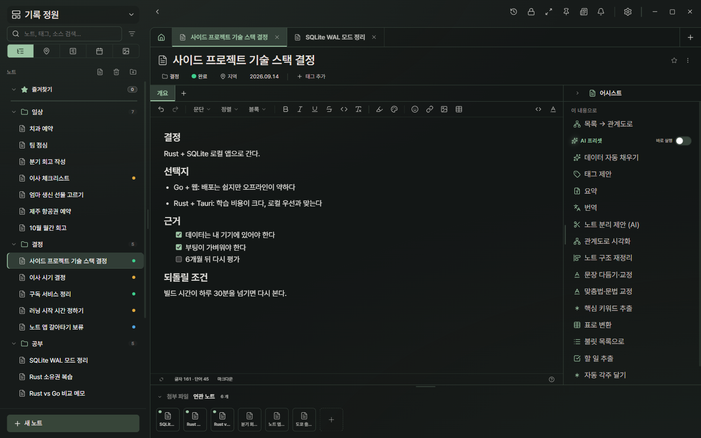
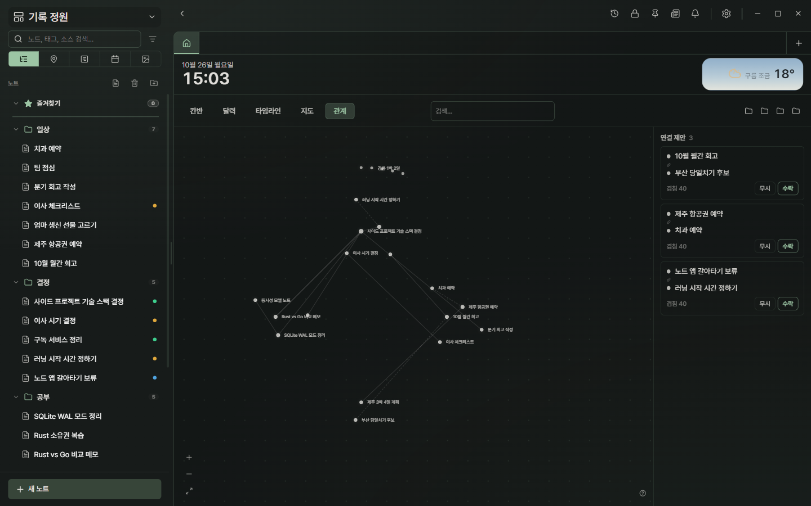
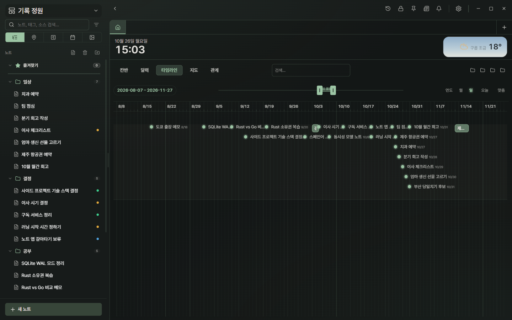
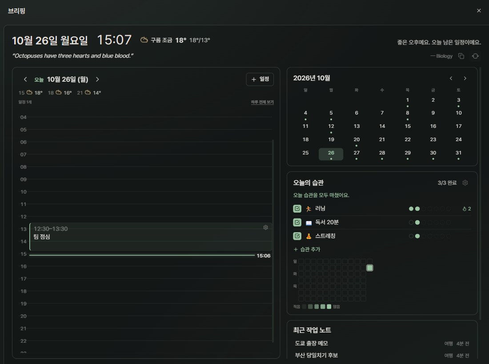
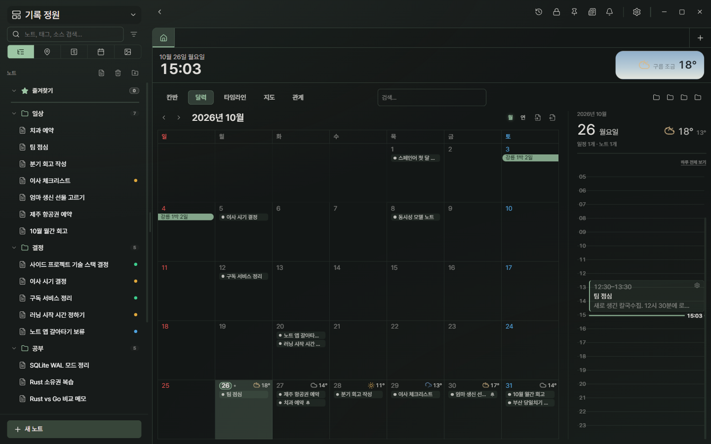
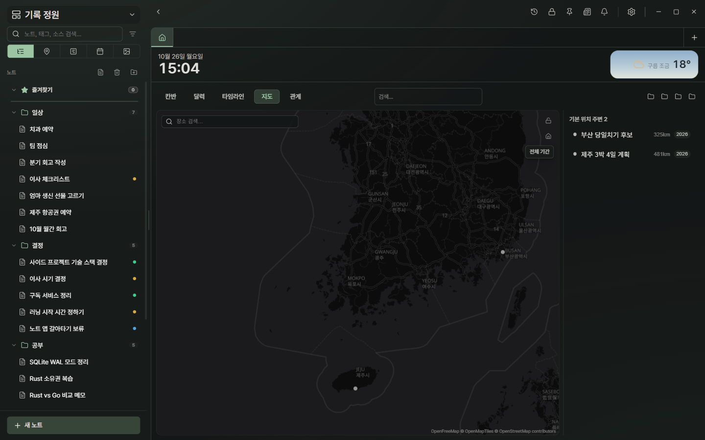
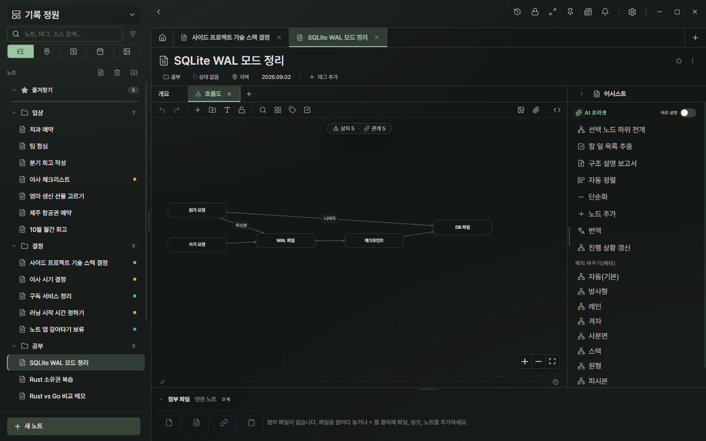
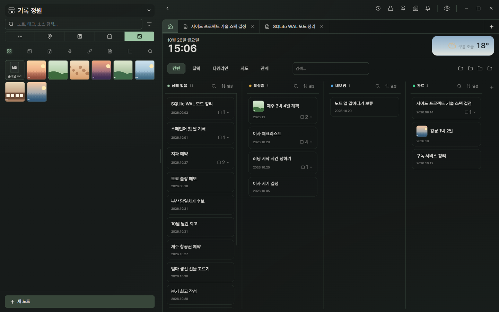

<div align="center">

# Brise

**기록의 무덤이 아닌, 정원으로.**

쌓인 기록을 여러 축으로 교차해 보면서, 인사이트는 사람이 직접 기르는 로컬 노트 앱.


</div>

---

## 개요

노트 앱에 기록을 쌓기만 하면 다시 열어 보지 않는 무덤이 된다.
LLM 위키 같은 방식은 쌓인 지식을 정리해 준다는 점에서 훌륭하다. 하지만 구조를 AI에게 맡기면 사람에게는 AI가 만든 결과물만 남고, 기록 사이의 연결을 스스로 발견할 기회가 줄어든다.

기록이 정원이 되려면 **같은 기록을 바라보는 여러 방식**이 필요하다. Brise는 쌓인 기록을 시간·장소·상태·관계의 여러 축으로 교차해 보여 줘서, 흩어진 메모가 서로 닿는 자리를 눈에 띄게 한다. 그 자리에서 의미를 찾는 것은 사람이다.

### 세 가지 원칙

1. **교차해서 본다** — 같은 기록이 타임라인·달력·지도·보드·관계도에 각각 다른 이웃과 함께 나타난다. 쌓인 데이터를 바라보는 축이 많을수록 뜻밖의 연결이 보인다.
2. **쾌적하다** — 기록할 때도, 쌓이는 동안도, 많이 쌓인 뒤에도 가볍다. 로컬 SQLite로 오프라인에서 동작하고, 부팅·검색 속도는 기준선을 두고 지킨다.
3. **내 데이터는 내 것** — 특정 클라우드나 AI에 묶이지 않는다. 노트는 내 기기에 있고, 동기화는 내 PC와 폰 사이(QR·Tailscale)로 이어진다. AI는 로컬(Ollama)을 포함해 여러 제공자 중 고르고, 꺼도 된다.

더 자세한 컨셉과 판단 기준: [docs/CONCEPT.md](docs/CONCEPT.md)

## 이럴 때 씁니다

### 의사결정을 정리한다
결정과 근거를 노트로 남기고, 근거가 된 학습 노트를 연결한다. 연결한 노트는 노트 아래 "연관 노트"에 모이고, 관계 탭에서는 노트 사이의 연결과 앱이 찾아낸 연결 제안이 한 그림으로 보인다. 타임라인에서는 앞뒤 사건과 나란히 놓인다. 몇 달 뒤 "그때 왜 그렇게 정했지"에 답이 된다.

 



### 하루·한 달 일정을 파악한다
브리핑 창이 오늘의 일정(시간축)·월 달력·오늘의 습관·최근 작업 노트를 한 화면에 모은다. 달력 탭에서는 월간 흐름과 기간 일정을 본다.

 

### 여행 계획을 짜고 정리한다
장소가 있는 노트는 지도에 올라가고, 날짜가 있는 노트는 달력에 올라간다. 같은 여행 노트를 두 축에서 맞춰 본다. 며칠에 걸친 여행은 달력에서 기간 막대로 보인다.



### 공부한 것을 정리한다
노트 하나에 섹션을 여러 개 두고(본문·시트·관계도), 각주로 출처를 단다. 쌓인 노트는 검색과 관계도로 다시 엮는다.



### 파일을 모아 둔다
사진·음성·문서를 노트에 첨부하고, 갤러리로 훑는다. 큰 파일은 복사하지 않고 참조한다.



> 화면의 노트는 모두 예시로 만든 가상의 기록이다.

## 부수 기능과 실험

- **수집 자동화** — 내게 필요한 지식을 꼭 내가 입력할 필요는 없다. RSS·웹·유튜브에서 모아 온다. 모으는 것까지만 자동이고, 의미를 찾는 것은 사람 몫이다.
- **연결** — 폰 동기화, 결제 문자 캡처, 외부 에이전트용 CLI·MCP 서버(`cli/`). 외부 앱 연동과 정책은 실험 단계다.
- **브리핑·습관** — 오늘을 조각하고 내일을 확인하는 화면, 반복 노트의 날짜별 체크.
- **펫** — 트레이에서 켜는 데스크톱 마스코트. 노트를 아는 대화, 빠른 메모, 알림, 화면 저장. 플러그인이라 꺼도 된다.

## 설치

[Releases](../../releases)에서 `Brise_<버전>_x64-setup.exe`(또는 `.msi`)를 받아 실행한다.
현재는 Windows만 지원하고, 자동 업데이트는 아직 동작하지 않아 수동 설치다.

## 만든 이의 말

Brise는 누구나 바이브코딩으로 만들어 봄직한 노트 앱에, 만든 사람의 철학을 담은 것입니다.
완성은 아니지만 데이터의 안정성만큼은 가장 공들였습니다. 재미있게 써 주시고, 피드백을 주시면 정말 감사하겠습니다.

## 라이선스

[Apache License 2.0](LICENSE)입니다. 번들된 서드파티 구성요소의 고지는 앱 안의 `THIRD-PARTY-NOTICES.html`(소스: `src-tauri/resources/`)에 있습니다. 기여 방법은 [CONTRIBUTING.md](CONTRIBUTING.md), 보안 신고는 [SECURITY.md](SECURITY.md)를 보세요.

## 개발자용

```bash
npm install
npm run tauri:dev      # 개발용 앱 식별자(com.brise.app.dev) — 실사용 데이터와 분리
```

`npm run tauri dev`(콜론 없음)는 **실사용 데이터**를 연다. vite 서버만 띄우지 말 것 — [docs/RUNNING.md](docs/RUNNING.md).

```
src/          React 프런트        src-tauri/    Rust 백엔드
specs/        SSOT 스펙(코드젠)   mobile-shell/ 안드로이드 셸
cli/          CLI · MCP 서버      docs/         기능별 문서
```

문서 목차는 [docs/README.md](docs/README.md), 릴리즈 절차는 [docs/RELEASING.md](docs/RELEASING.md).
