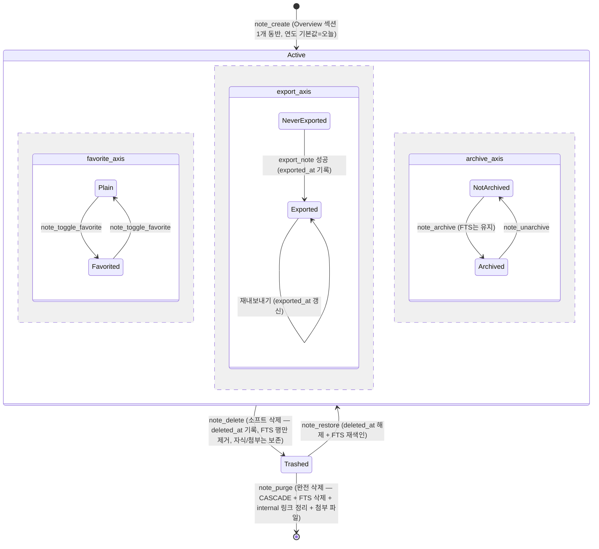

# Note 생명주기

`notes` 행의 상태는 컬럼 조합으로 표현된다: `is_favorite`, `exported_at`, `deleted_at`(V12, Trash),
`archived_at`(W7-f, Trash와 나란한 별도 소프트 상태). 직교(orthogonal) 플래그이므로 상태 폭발 대신
축으로 그린다. 상세 계약은 `commands/notes.yaml`.

## 불변 조건
- Active인 동안 `sections`는 항상 ≥ 1행 (마지막 섹션 삭제는 CONFLICT)
- `exported_at`은 단조 증가 (내보내기 성공시에만 갱신, null 복귀 없음)
- 삭제(purge) 후 동일 id 재사용 없음 (UUIDv4)
- Trashed 노트는 목록/검색/related/노트북 note_count 등 모든 노출 경로에서 제외되지만
  `note_get`(단일 조회)과 `note_trash_list`에는 나타난다
- Archived 노트는 트리/대시보드/태그 집계에서 숨지만 `search_notes`에는 계속 나온다 —
  Trash와 달리 FTS 행이 지워지지 않는다
- 아카이브 후 삭제된 노트(둘 다 세팅)는 휴지통 화면에만 나온다(`note_archived_list`가 제외)

## 편집 하위 흐름 (UI 상태 — DB 상태 아님)
Editing → `Saving…`(700ms 디바운스) → `Saved · just now` / 실패 시 재시도 1회 → 에러 토스트
